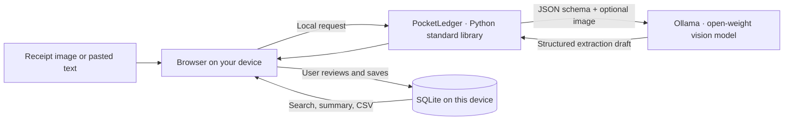

# PocketLedger

**Your freelance money. Your machine.** PocketLedger turns paper receipts and digital invoices into a searchable, exportable expense ledger with open-weight AI running on your own computer.

## The problem

Independent designers, developers, photographers, and consultants often finish a client project with receipts scattered across email, a camera roll, and a wallet. At tax time, they still have to remember what each purchase was for, which client it belonged to, and whether they already logged it. General accounting suites can be more product than a solo freelancer needs, while cloud AI receipt tools ask users to send invoices, purchase details, and sometimes personal information to a service they do not control.

**PocketLedger is for the solo freelancer who wants the tedious first pass done without handing over their books.** Drop in a receipt image or paste its text. A local vision model drafts the merchant, date, amount, currency, and category. The freelancer checks and edits every field, assigns a client or project, marks the expense for tax records, and saves it to a private local ledger. Search the ledger or export it as CSV for a bookkeeper.

## Who would pay for it?

The first customer is an independent freelancer who wants a fast receipt workflow without a monthly cloud accounting subscription. The business hypothesis is a one-time paid desktop setup, with optional paid onboarding and support for freelancers who want help choosing a local model or preparing a bookkeeper-friendly export. There is no per-receipt API bill, so usage does not add inference costs. The willingness-to-pay hypothesis still needs real freelancer interviews and a first-user trial.

## What it does

- Extracts receipt details from JPG, PNG, or WEBP images, or pasted receipt text, using a local Ollama model.
- Shows the AI draft in an editable review form; nothing is added to the ledger until the user saves it.
- Records category, currency, client or project, and a user-controlled business-deductible flag.
- Provides a searchable ledger, monthly spending view, category breakdown, and CSV export.
- Stores structured records in SQLite on the current device. Receipt images are processed in memory and discarded after extraction.
- Works without Ollama for manual expense entry. Once Python, Ollama, and the model are installed, the app can run without an internet connection.

## Run it

Requirements: Python 3.10 or newer and [Ollama 0.7.0 or newer](https://ollama.com/download). The default `qwen2.5vl:3b` vision model is about 3.2 GB to download. The web app uses only Python's standard library; there is no `pip install` step.

1. Install Ollama, start it, and download a vision model once:

   ```sh
   ollama pull qwen2.5vl:3b
   ```

2. From this folder, start PocketLedger:

   ```sh
   python main.py
   ```

3. Open [http://127.0.0.1:8000](http://127.0.0.1:8000).

The first model run may take longer while Ollama loads it. The AI status at the top of the page shows whether Ollama and the selected model are ready. If they are unavailable, manual entry and the local ledger still work.

### Settings

Set environment variables before starting the app to change its local configuration:

| Variable | Default | Purpose |
| --- | --- | --- |
| `OLLAMA_MODEL` | `qwen2.5vl:3b` | Ollama vision model tag |
| `OLLAMA_URL` | `http://127.0.0.1:11434` | Ollama address; keep it on loopback for local use |
| `POCKETLEDGER_DB` | `./pocketledger.db` | Local SQLite database path |
| `PORT` | `8000` | Local web app port |

For example, in PowerShell you can set `$env:OLLAMA_MODEL = "your-vision-model"` before `python main.py`. Choose an Ollama model that supports both image input and JSON-schema output.

## How it works



The app binds to `127.0.0.1`, sends inference requests only to the configured Ollama endpoint, and does not call a hosted AI API. Ollama receives the image only for the extraction request. PocketLedger does not save the original image. Structured fields are returned to the form and persisted only when the user chooses **Save expense**.

## Why open innovation matters here

Receipt images reveal spending habits, vendors, dates, and sometimes addresses or partial payment information. A closed cloud model would require sending those details to an outside service and could add a fee to every scan. With an open-weight model served locally by Ollama, the private extraction step stays on the freelancer's computer, and after the model download the workflow can run offline. There is no per-token bill or vendor lock-in: users can choose another compatible vision model, change the prompt, or adapt the schema to their bookkeeping needs.

The open approach works especially well for this narrow task: read a short business document and draft a small, predictable set of fields. The model does not decide tax treatment or silently book anything. People review its suggestions, correct mistakes, and remain responsible for whether an expense is deductible.

## Privacy and practical limits

- This is a local desktop utility, not a hosted multi-user service. Keep it bound to `127.0.0.1` and do not expose its port to a public network.
- Install Python, Ollama, and the chosen model before expecting the app to work fully offline. Model downloads need internet access once.
- Extraction quality depends on the model, image quality, handwriting, and receipt layout. Review the merchant, date, currency, and total before saving.
- Currency totals are never converted. The overview charts one currency at a time; each ledger row retains its original currency.
- The deductible marker is a personal bookkeeping aid, not tax advice or an automatic tax determination.
- PocketLedger does not encrypt the local SQLite file. Use your device's disk encryption and account protections if the data is sensitive.

## Built with

Python standard library · SQLite · HTML · CSS · JavaScript · Ollama · Qwen2.5-VL (default model)

## Hacktoberfest

PocketLedger is a new open-source AI project for the **Side Hustle** theme. The project focuses on a small workflow with a clear customer: freelancers who want private receipt capture and client-aware expense tracking without a recurring cloud inference fee. A useful next step is to put it in front of one freelancer, watch them log a real expense, and revise the workflow based on what slows them down.

The [Hacktoberfest Open-Source AI Challenge: Week 2](https://dev.to/challenges/hacktoberfest-week2-2026-10-12) closes **October 18, 2026 at 11:59 PM PDT** (October 19 at 12:29 PM IST) and asks participants to publish a project write-up on DEV with the `devchallenge` and `hf26challenge` tags.

See [`SUBMISSION.md`](SUBMISSION.md) for a draft project write-up to adapt after trying the app.

## Contributing

Issues and pull requests are welcome. Before a larger change, open an issue to agree on the scope. Keep the local-first promise intact: no hosted AI calls, no uploading original receipts, and no logging receipt contents.

## License

MIT. See [`LICENSE`](LICENSE).
